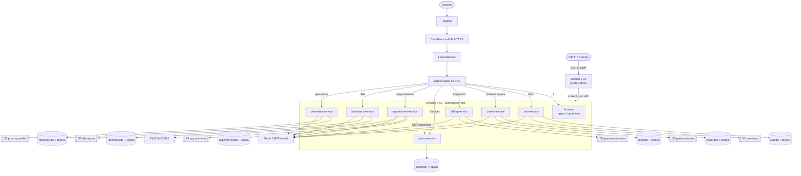

# CarePulse

A cloud-hosted hospital management system. Staff can register patients, hand out queue tokens, record 5 weeks of
patient progress (with photos), take payments and email receipts, book doctors, order lab tests and sell medicines. Everything is created and deployed
automatically from GitHub, and it gets a clean web address (Route53 + CloudFront) and a monitoring stack
(Prometheus, Grafana, Loki).


### Dashboard


*The admin dashboard: patients on record, doctors, today's appointments, queue, total revenue and the 7-day charts.*

## What it does

- **Login** (there is no public sign-up: the first admin comes from a GitHub secret, and only an admin can create other accounts from the **Users** page)
- **Patients**: registration, search, details, 5-week symptom records with photo upload (saved weeks cannot be changed)
- **Welcome email**: every sign-in sends "Welcome to our CarePulse" to the user's email
- **Doctors**: a separate `doctor` service with its **own database** (`hms-doctordb` + read replica). Admins can add doctors and change fees; doctors are never deleted, only set inactive. The seeded doctors have ids 1 to 6.
- **Laboratory**: a separate `laboratory` service with its **own database** (`hms-laboratorydb` + read replica) and **own S3 bucket** (`hms-<account>-lab-reports`). Order a test for a patient, mark the sample collected, enter the result (optional PDF or image report). The patient is emailed when the test is ordered and when the result is ready.
- **Pharmacy**: a separate `pharmacy` service with its **own database** (`hms-pharmacydb` + read replica) and **own S3 bucket** (`hms-<account>-pharmacy-bills`). Medicine stock, sales and bills. A sale takes stock and saves the bill in one database transaction, so stock never goes below zero. The bill is emailed to the patient.
- **Doctor appointments**: pick a doctor, date and free time slot; the doctor name, date and time are emailed to the user (cancel/complete also email). Doctor details come from the `doctor` service and are copied into each booking. Handled by a separate `appointment` service with its **own database** (`hms-appointmentdb` + read replica) and **own S3 bucket** (`hms-<account>-appointments`). Booking status (`booked` / `cancelled` / `completed`) is stored in the `appointments.status` column and as a versioned JSON record `appointments/<id>.json` in that bucket.
- **Queue**: daily tokens with waiting / in consultation / done
- **Payments**: receipts stored in S3, printable, and emailed
- **Admin pages**: weekly report for all patients, user management
- **Languages**: English, Hindi, Odia
- **Safety**: a database trigger blocks every `DELETE`, so saved data cannot be removed
- **Own web address**: `https://ritikhms.<your-domain>` through Route53 and CloudFront (HTTPS)
- **Monitoring**: CPU/memory dashboards, pod logs (Loki) and CPU alert emails

## Tech stack

| Area | What is used |
|---|---|
| Cloud | AWS (`us-east-1`) |
| Infrastructure as code | Terraform 1.10.5 (state in an S3 bucket) |
| Network | VPC, 2 public + 2 private subnets, NAT gateway |
| Containers | Docker, Amazon ECR |
| Orchestration | Amazon EKS (Kubernetes), managed node group |
| Kubernetes client | Public bastion EC2 server in the same VPC (`terraform/bastion.tf`) with `kubectl` and `helm` |
| Database | Amazon RDS PostgreSQL 16, one primary + one read replica per service (auth, patient, billing, appointment, doctor, laboratory, pharmacy) |
| Storage | 6 encrypted, versioned S3 buckets: `user-data`, `payment-receipts`, `patient-photos`, `appointments`, `lab-reports`, `pharmacy-bills` |
| Email | Amazon SNS (email subscriptions) |
| Pod permissions | IAM role for service accounts (IRSA), no `s3:DeleteObject` on purpose |
| Backend | Python 3.12, FastAPI, 7 services: `auth`, `patient`, `billing`, `appointment`, `doctor`, `laboratory`, `pharmacy` |
| Frontend | One `index.html` (plain HTML, CSS, JavaScript) served by nginx |
| Traffic | ingress-nginx (installed through ArgoCD) in front of the app |
| Web address | Route53 record -> CloudFront (HTTPS, ACM certificate) -> ingress-nginx load balancer |
| Monitoring | Prometheus, Grafana, Alertmanager (email alerts), Loki + Promtail (pod logs), installed with Helm |
| CI/CD | GitHub Actions, Trivy image scanning, ArgoCD (GitOps) |

## Architecture

Every service has its **own database** (a PostgreSQL primary for writes and a read replica for reads) and, where it stores files, its **own S3 bucket**. Services never read each other's database. The only service-to-service call is `appointment` asking `doctor` for doctor details when a booking is made.



| Service | URL paths | Database | S3 bucket | Sends email |
|---|---|---|---|---|
| `auth` | `/auth` | `hms-authdb` | `user-data` | welcome mail on login |
| `patient` | `/patients`, `/queue` | `hms-patientdb` | `patient-photos` | registration, patient details |
| `billing` | `/payments` | `hms-billingdb` | `payment-receipts` | payment receipt |
| `doctor` | `/doctors` | `hms-doctordb` | none | no |
| `appointment` | `/appointments` | `hms-appointmentdb` | `appointments` | booking, payment, cancel, refund (SMS on confirm) |
| `laboratory` | `/lab` | `hms-laboratorydb` | `lab-reports` | test ordered, result ready |
| `pharmacy` | `/pharmacy` | `hms-pharmacydb` | `pharmacy-bills` | pharmacy bill |

Shared by all services (`services/common.py`): JWT login check, database helpers (writes go to the primary, reads to the replica), S3 upload, email, and a database trigger that blocks every `DELETE`.

## How it fits together

```
 push to main
     │
     ▼
 terraform-infra ──► VPC · EKS · RDS · S3 · SNS · IAM · bastion   (terraform.yml)
     │ only if successful
     ▼
 cicd ──► build images ─► Trivy scan ─► push to ECR           (docker-build.yml)
      ──► write image names into k8s/ and commit
      ──► install ArgoCD ─► ArgoCD deploys k8s/ to EKS
      ──► prints the app URL and the ArgoCD URL + password
     │ only if successful, these two start at the same time
     ├──────────────────────────────┐
     ▼                              ▼
 edge-cloudfront                 monitoring
 (edge-cloudfront.yml)           (monitoring.yml)
 finds the load balancer,        installs Prometheus, Grafana,
 applies terraform/dns.tf:       Alertmanager and Loki,
 ACM + CloudFront + Route53,     prints the Grafana URL, username,
 prints https://hms.<domain>     password and the Prometheus URL

 manual only:  monitoring-tools (monitoring-tools.yml)
               reset the Grafana password / test the CPU email alert

 Browser ──► Route53 ──► CloudFront ──► load balancer ──► ingress-nginx ──┬─ /auth      → auth-service
                                                                          ├─ /patients  → patient-service
                                                                          ├─ /queue     → patient-service
                                                                          ├─ /payments  → billing-service
                                                                          ├─ /doctors   → doctor-service
                                                                          ├─ /appointments → appointment-service
                                                                          ├─ /lab       → laboratory-service
                                                                          ├─ /pharmacy  → pharmacy-service
                                                                          └─ /          → frontend
```

## Repository layout

```
.
├── .github/workflows/
│   ├── terraform.yml          # workflow "terraform-infra": builds the AWS infrastructure
│   ├── docker-build.yml       # workflow "cicd": images, scan, deploy (runs after terraform-infra)
│   ├── edge-cloudfront.yml    # CloudFront + Route53 (runs after cicd), prints the app URL
│   ├── monitoring.yml         # Prometheus + Grafana + Loki (runs after cicd), prints the Grafana login
│   ├── monitoring-tools.yml   # manual: reset Grafana password, CPU alert test
│   └── debug-cluster.yml      # manual: cluster checks
├── terraform/                 # main.tf, rds.tf, dns.tf, bastion.tf, variables.tf, outputs.tf, terraform.tfvars
├── services/
│   ├── Dockerfile             # one Dockerfile for all 7 services (build arg SERVICE)
│   ├── requirements.txt       # Python dependencies (keep these patched, Trivy fails the build otherwise)
│   ├── common.py              # shared DB, JWT, S3 and SNS helpers
│   ├── auth/main.py           # login, users (admin creates accounts), email test
│   ├── patient/main.py        # patients, weekly records, queue, email details
│   ├── billing/main.py        # payments, receipts, receipt email
│   ├── appointment/main.py    # bookings and booking status (own DB + S3 bucket), asks doctor-service for doctor details
│   ├── doctor/main.py         # doctor directory (own DB)
│   ├── laboratory/main.py     # lab tests, orders, results (own DB + S3 bucket)
│   └── pharmacy/main.py       # medicines, stock, sales, bills (own DB + S3 bucket)
├── docs/images/               # screenshots used in this README
├── frontend/
│   ├── Dockerfile             # nginx-unprivileged + index.html
│   └── index.html             # the whole user interface
├── k8s/                       # deployments, services, ingress, config
├── monitoring/                # Helm values, Loki log dashboard, monitoring README
└── argocd/application.yaml    # ArgoCD apps: ingress-nginx and hospital-management
```

## Before you deploy

You need:

- An **AWS account** that allows EKS, RDS, EC2, S3, SNS, IAM, CloudFront, ACM and Route53. Sandbox accounts often block some of these or limit EC2 sizes.
- An **IAM user** with an access key (AdministratorAccess is the easiest for a test project).
- A **Route53 public hosted zone** for your domain (for example `855455101846.realhandsonlabs.net`).
- A **GitHub repository** with this code on the `main` branch.
- If the repository is **private**, ArgoCD needs credentials to read it. A public repository works without extra setup.
- An existing **EC2 key pair** in `us-east-1` (this project uses `ritik`) if you want SSH access to the bastion server.

### 1. Add GitHub secrets

Repo → **Settings → Secrets and variables → Actions → New repository secret**.

These are the secrets this project uses (all 15 are already added in this repo):

| Secret | Used by | Value |
|---|---|---|
| `ADMIN_EMAIL` | cicd | Email of the first admin account |
| `ADMIN_PASSWORD` | cicd | Password of the first admin account |
| `ALERT_SMTP_PASSWORD` | monitoring | Gmail **app password** used by Alertmanager to send CPU alert emails |
| `AWS_ACCESS_KEY_ID` | all workflows | Access key of your IAM user |
| `AWS_REGION` | all workflows | AWS region to deploy to, for example `us-east-1` |
| `AWS_SECRET_ACCESS_KEY` | all workflows | Secret key of your IAM user |
| `DB_PASSWORD` | terraform-infra, cicd | Database master password (8+ characters, no `/`, `@`, `"` or spaces) |
| `DB_USERNAME` | terraform-infra, cicd | Database master username, for example `hmsadmin` (not `admin`, it is reserved) |
| `GH_PAT` | cicd | GitHub personal access token, used instead of the built-in `GITHUB_TOKEN` to push manifests |
| `GH_USERNAME` | cicd | Your GitHub username |
| `JWT_SECRET` | cicd | A long random string used to sign login tokens |
| `SMTP_PASS` | cicd | Mail password the app uses to send emails |
| `TFVARS` | terraform-infra, edge-cloudfront | Full contents of `terraform.tfvars`, including `hosted_zone_name` and the bastion lines (see step 2). It replaces the file in the repo on every run |

Optional secrets you have not set: `PROMETHEUS_ALLOWED_CIDR` (for example `203.0.113.10/32`, limits who can open Prometheus, which has no login) and `HOSTED_ZONE_NAME` (only needed if `hosted_zone_name` is not in `TFVARS`).

`GITHUB_TOKEN` is created by GitHub automatically; you cannot add it as a secret.
Also set **Settings → Actions → General → Workflow permissions** to **Read and write**.

The Grafana username and password are written at the top of `.github/workflows/monitoring.yml` (`GRAFANA_USER`, `GRAFANA_PASSWORD`), so the two `GRAFANA_ADMIN_*` secrets are no longer needed.

### 2. Check `terraform/terraform.tfvars` (or the `TFVARS` secret)

```hcl
region              = "****"
project             = "*****"
cluster_name        = "hms-eks"
eks_version         = "1.31"          # see "EKS version" below
node_instance_types = ["t3.medium"]    # use a smaller type if your account blocks this one
node_min_size       = 2
node_max_size       = 4
node_desired_size   = 3

# web address (used by terraform/dns.tf)
hosted_zone_name = "*****.realhandsonlabs.net"   # your Route53 public hosted zone
app_subdomain    = "ritikcarepulse"                                # gives https://ritikcarepulse.******.realhandsonlabs.net

# one database (+ read replica) per service, and the S3 buckets
db_services  = ****
data_buckets = ****

# public client server (bastion) used to run kubectl against EKS (terraform/bastion.tf)
bastion_key_name      = "ritik"                  # existing EC2 key pair in us-east-1
bastion_allowed_cidrs = ["YOUR.PUBLIC.IP/32"]    # your public IP only, never 0.0.0.0/0
```

Keep `hosted_zone_name` in the file or secret permanently. If it is removed later, the next run would remove CloudFront and the Route53 record.
If you change `region`, `project` or `cluster_name`, also update the workflows and the files in `k8s/`.

The two `bastion_*` lines must also be in the `TFVARS` secret. Otherwise the pipeline applies the defaults (no SSH key, SSH closed, SSM only).

## Deploy

1. Commit and push everything to `main`.
2. Open the **Actions** tab. The workflows run one after the other:
   1. **terraform-infra** creates the S3 state bucket and all AWS resources. This takes **25 to 40 minutes** the first time (EKS and RDS are slow).
   2. **cicd** starts by itself when the first one succeeds. It builds the images, scans them, pushes them to ECR, installs ArgoCD and deploys the app.
   3. **edge-cloudfront** and **monitoring** start by themselves when **cicd** succeeds.
3. Read the **Summary** page of each finished run:
   - **cicd**: ArgoCD URL, username (`admin`) and password, plus the plain load balancer URL.
   - **edge-cloudfront**: the **application URL**, `https://hms.<your-domain>`. Log in with `ADMIN_EMAIL` and `ADMIN_PASSWORD`. The first run takes about 5 to 10 minutes because CloudFront and the certificate are slow.
   - **monitoring**: Grafana URL, username and password, and the Prometheus URL.

You can also start any workflow by hand from the **Actions** tab with **Run workflow**.

To release a change later, just push to `main`. Only changes to `terraform/`, `services/`, `frontend/` or the workflow files start a new run.

## Using the app

- **Admin:** sign in with `ADMIN_EMAIL` / `ADMIN_PASSWORD`. Admins see the Weekly report and Users pages and can create other admins.
- **Create accounts:** the login page has no sign-up. Sign in as admin, open **Users**, and use **Add user** (name, email, password, role `employee` or `admin`). Staff then sign in with the email and password the admin gave them.
- **Email:** emails go out through Amazon SNS. Each address must confirm once by clicking **Confirm subscription** in the message AWS sends. Until then no emails arrive. The **Account** page has **Resend email** and **Send test email** buttons.

## Monitoring

Installed by `monitoring.yml` after every successful deploy. Full guide: [monitoring/README.md](monitoring/README.md).

- **Grafana**: dashboards for node and pod CPU, memory and network, plus **Pod Logs (Loki)**.
- **Logs**: Grafana → **Explore** → data source **Loki**, one query at a time, for example `{namespace="hms"}` (app logs) or `{namespace=~".+"}` (everything).
- **Alerts**: `NodeHighCPU` (node above 80% for 5 min) and `PodHighCPU` (pod above 0.8 core for 5 min) are emailed through Alertmanager.
- **Manual tools**: Actions → **monitoring-tools** → Run workflow → choose `reset-grafana-password`, `test-cpu-alert` or `delete-cpu-test`.

## API overview

| Method and path | Who | Purpose |
|---|---|---|
| `POST /auth/login` | public | Get a login token |
| `POST /auth/register` | admin | Create a user with any role |
| `GET /auth/users` | admin | List users |
| `POST /auth/notifications/resend` / `test` | signed in | Re-send the AWS confirmation email / send a test email |
| `GET/POST /patients`, `GET /patients/{id}` | signed in | List, add, view patients |
| `POST /patients/{id}/weeks` | signed in | Save week 1 to 5 (symptoms and photo) |
| `POST /patients/{id}/token`, `GET /queue`, `PATCH /queue/{id}` | signed in | Queue |
| `POST /patients/{id}/email` | signed in | Email patient details |
| `GET /patients/weekly-report` | signed in | All patients' weekly records |
| `POST/GET /payments`, `GET /payments/{id}/receipt`, `POST /payments/{id}/email` | signed in | Payments and receipts |
| `GET /doctors`, `GET /doctors/{id}` | signed in | List doctors, get one doctor |
| `POST /doctors`, `PATCH /doctors/{id}` | admin | Add a doctor, change fee / speciality / active |
| `GET /appointments/slots/{doctor_id}?date=` | signed in | Free time slots of a doctor |
| `POST/GET /appointments`, `POST /appointments/{id}/pay`, `/cancel` | signed in | Book, list, pay, cancel |
| `POST /appointments/{id}/confirm`, `/complete` | admin | Confirm (SMS) and complete a booking |
| `GET /lab/tests` | signed in | Lab test catalogue |
| `POST /lab/tests` | admin | Add a lab test |
| `POST/GET /lab/orders` | signed in | Order a test, list orders (admin sees all) |
| `PATCH /lab/orders/{id}/status` | signed in | Mark `sample-collected` or `cancelled` |
| `POST /lab/orders/{id}/result`, `GET /lab/orders/{id}/report` | signed in | Save the result (text + optional file), get the report file link |
| `GET /pharmacy/medicines` | signed in | Medicines and stock |
| `POST /pharmacy/medicines`, `POST /pharmacy/medicines/{id}/restock` | admin | Add a medicine, add stock |
| `POST/GET /pharmacy/sales`, `GET /pharmacy/sales/{id}/bill` | signed in | Sell medicines, list sales, get the bill link |

## Bastion server (kubectl client inside the VPC)

`terraform/bastion.tf` creates a small EC2 server (Amazon Linux 2023, `t3.micro`) in a **public subnet** of the same VPC. It has an Elastic IP, and `kubectl`, `helm`, `git` and `jq` are installed on first boot. Terraform also:

- opens port 443 of the EKS cluster security group to the bastion, so `kubectl` can reach the API;
- creates an IAM role and an EKS access entry (`AmazonEKSClusterAdminPolicy`), so `kubectl` is allowed in;
- opens SSH (port 22) only to the IPs in `bastion_allowed_cidrs`.

Outputs after the pipeline runs: `bastion_public_ip`, `bastion_instance_id`, `bastion_ssm_command`.

Connect with SSH (the key pair `ritik` must exist in `us-east-1`):

```bash
chmod 400 ritik.pem
ssh -i ritik.pem ec2-user@<bastion_public_ip>
kubectl get nodes
kubectl config set-context --current --namespace=hms   # so you do not need -n hms every time
```

Or with AWS Systems Manager (needs the Session Manager plugin and `ssm:StartSession` permission):

```bash
aws ssm start-session --target <bastion_instance_id> --region us-east-1
sudo su - ec2-user
```

On Windows, if SSH complains about the key file permissions:

```powershell
icacls C:\Users\ritik\ritik.pem /inheritance:r /grant:r "$($env:USERNAME):R"
```

To remove the server, set `bastion_enabled = false` in `terraform.tfvars` and push.

## Useful commands

Connect to the cluster (use the same AWS account as the pipeline, or run these on the bastion server):

```bash
aws eks update-kubeconfig --name hms-eks --region us-east-1
kubectl -n hms get pods
kubectl -n hms logs deploy/auth-service
kubectl -n argocd get applications
kubectl -n ingress-nginx get svc
kubectl -n monitoring get pods
```

Get the ArgoCD password later:

```bash
kubectl -n argocd get secret argocd-initial-admin-secret -o jsonpath='{.data.password}' | base64 -d
```

## Troubleshooting

### 1. Grafana: "Login failed - Invalid username or password"

**Cause:** the old `monitoring.yml` printed the password with a space between each character (to get around GitHub hiding secrets), and the spaces were typed in as part of the password.

**Fix:**
1. Type the password with no spaces.
2. The login is now written at the top of `.github/workflows/monitoring.yml` (`GRAFANA_USER` and `GRAFANA_PASSWORD`), and the monitoring run prints it in plain text.
3. If it still fails, Grafana kept an old password in its database. Run **Actions → monitoring-tools → Run workflow → `reset-grafana-password`**, or re-run **monitoring**.

### 2. Loki (Grafana Explore): "parse error at line 5, col 1: syntax error: unexpected {"

**Cause:** several queries were pasted into one query box. Loki runs only one query at a time.

**Fix:**
1. Click in the box, press **Ctrl+A**, then **Delete**.
2. Paste one query only, for example `{namespace="hms"}`.
3. Run it with **Shift+Enter** or the blue refresh button (set the time range to **Last 1 hour**).
4. To run more than one query, click **Add query** and put one query in each box.

### 3. Pod status "CrashLoopBackOff"

**Cause:** the container starts, crashes and restarts again and again. The usual reason is a wrong database username or password, or a database the pod cannot reach.

**Fix:**
1. Read the reason: `kubectl -n hms logs <pod> --previous` (find the pod name with `kubectl -n hms get pods`).
2. If the log shows a database or authentication error, correct `DB_USERNAME` and `DB_PASSWORD` (see problem 4).
3. Run **terraform-infra** and then **cicd** again so the pods get the right credentials.
4. Restart the pods: `kubectl -n hms rollout restart deploy`.
5. Also check that the secret `JWT_SECRET` is set and that the `*db-conn` secrets exist: `kubectl -n hms get secret`.

### 4. terraform-infra fails: wrong database credentials

**Cause:** RDS refuses the master username or password.

**Fix:**
1. The username must not be `admin` (it is reserved). Use something like `hmsadmin`.
2. The password must be 8 or more characters and must not contain `/`, `@`, `"` or a space.
3. Correct the `DB_USERNAME` and `DB_PASSWORD` secrets exactly, with no space at the end.
4. Re-run **terraform-infra**. If the database already exists, the new password is applied on the next successful run.
5. Run **cicd** after it, so the pods get the new credentials (see problem 3).

### 5. Booking page: time slots show "Not Found" after choosing a doctor and date

**Cause:** the page asks `GET /appointments/slots/{doctor_id}?date=...`, but the running `appointment-service` pod was on an **older image** that does not have this route. ECR had a newer image (tag `efae1bf...`, also `latest`), while the pod still ran `bff161d...`, because the image tag in the `k8s/` manifest was not updated.

**How to confirm:**
1. Check the image the pod runs:
   ```bash
   kubectl -n hms get deploy appointment-service -o jsonpath='{.spec.template.spec.containers[0].image}'
   ```
2. Check that the route exists inside the pod:
   ```bash
   kubectl -n hms exec deploy/appointment-service -- python -c "import urllib.request;print(urllib.request.urlopen('http://localhost:8000/openapi.json').read().decode())" | grep -o '"/appointments/slots[^"]*"'
   ```
   Nothing printed means the pod has the old code.

**Fix:**
1. Quick test: set the new image by hand.
   ```bash
   kubectl -n hms set image deployment/appointment-service \
     app=497046674646.dkr.ecr.us-east-1.amazonaws.com/hospital-management-appointment:<new-tag>
   kubectl -n hms rollout status deployment/appointment-service
   ```
2. ArgoCD can undo a manual change (auto-sync). For a permanent fix, put the new tag in the `k8s/` manifest, commit and push to `main`, or re-run the failed **cicd** workflow so it writes the image names into `k8s/` again.
3. Reload the booking page and pick the doctor and date again.

### 6. kubectl: `Error from server (NotFound): pods "..." not found`

**Cause:** the app runs in the `hms` namespace, but `kubectl` looks in `default` when no namespace is given.

**Fix:** add `-n hms` (for example `kubectl describe pod <pod> -n hms`), or set it once:

```bash
kubectl config set-context --current --namespace=hms
```

Typing mistakes give a different error, `unknown command "describw" for "kubectl"` or `the server doesn't have a resource type "epod"`. Check the spelling of `describe` and `pod`.

### 7. `ws: command not found` / `unknown command` when starting an SSM session

**Cause:** the command was typed without the first letter (`ws` instead of `aws`), or the region was left as `***`.

**Fix:** use the full command with a real region:

```bash
aws ssm start-session --target i-xxxxxxxxxxxxxxxxx --region us-east-1
```

### 8. SSM: `An error occurred (403) when calling the StartSession operation ... Forbidden`

**Cause:** AWS refused the request before it reached the server, so this is a credentials or permissions problem, not a Terraform or EKS problem. Common reasons: expired or wrong AWS credentials, a Windows clock that is out of sync, no `ssm:StartSession` permission, or a lab account policy (SCP) that blocks Session Manager.

**Fix:**
1. Check who you are: `aws sts get-caller-identity` and `aws configure list` (region must be `us-east-1`).
2. Turn on automatic time in Windows (Settings, Time & Language).
3. Try EC2 console, the instance, Connect, Session Manager. If that also fails, the account blocks SSM.
4. Use SSH instead (see "Bastion server"): `ssh -i ritik.pem ec2-user@<bastion_public_ip>`. Make sure `bastion_allowed_cidrs` has your current public IP.

### 9. Bastion: `kubectl` problems

| Symptom | Cause | Fix |
|---|---|---|
| `Unauthorized` | the EKS access entry for the bastion role does not exist yet | check that `aws_eks_access_policy_association.bastion` applied |
| timeout | port 443 from the bastion to the EKS cluster security group is missing | check `aws_security_group_rule.eks_api_from_bastion` |
| `kubectl: command not found` or no kubeconfig | first-boot script still running or failed | wait 1 to 2 minutes, read `/var/log/cloud-init-output.log`, then run `aws eks update-kubeconfig --name hms-eks --region us-east-1` |
| `InvalidKeyPair.NotFound` during apply | the key pair `ritik` is not in `us-east-1` | create it in `us-east-1` or change `bastion_key_name` |
| SSH `Connection timed out` | your public IP is not in `bastion_allowed_cidrs` (your IP changed) | update the value in `TFVARS` and re-apply |

## Cost and clean-up

This setup is not free: the EKS control plane, worker nodes, a NAT gateway, fourteen RDS instances (seven primaries and seven read replicas), the bastion server and its Elastic IP, CloudFront and the load balancers
(app, ArgoCD, Grafana, Prometheus) all cost money while they run. Destroy everything when you are done:

1. Delete the load balancers first, or the VPC cannot be removed:
   ```bash
   kubectl -n ingress-nginx delete svc ingress-nginx-controller
   kubectl -n argocd delete svc argocd-server
   helm -n monitoring uninstall kube-prometheus-stack loki
   ```
2. In `terraform.tfvars` set `db_deletion_protection = false` and apply it once (push to `main`).
3. Run `terraform destroy` from the `terraform/` folder, with the same backend settings as the workflow. This also removes the bastion server, CloudFront, the certificate and the Route53 records created by `dns.tf`.
4. Delete by hand what Terraform does not manage: the seven ECR repositories (`hospital-management-*`) and the state bucket `hms-tfstate-<account-id>`.

## Security notes

- Never commit real secrets. Use GitHub secrets only.
- The pipeline prints the ArgoCD admin password in the run summary, and `monitoring.yml` prints the Grafana password. In a public repository anyone can read them, so make the repository private, or change the passwords after the first login.
- The Grafana password is written in `monitoring.yml` in plain text. Change `GRAFANA_PASSWORD` to your own value and keep the repository private.
- Prometheus has no login. Set the `PROMETHEUS_ALLOWED_CIDR` secret to limit who can open it.
- There is no public sign-up: only an admin can create accounts, so nobody with just the URL can get staff access. Use strong passwords for the admin account.
- The Kubernetes API is public (`cluster_endpoint_public_access = true`) so GitHub runners can deploy. Restrict it for production.
- The bastion server has cluster-admin rights on EKS. Keep `bastion_allowed_cidrs` limited to your own IP (never `0.0.0.0/0`), keep the `ritik.pem` private key safe, and set `bastion_enabled = false` when you do not need it.